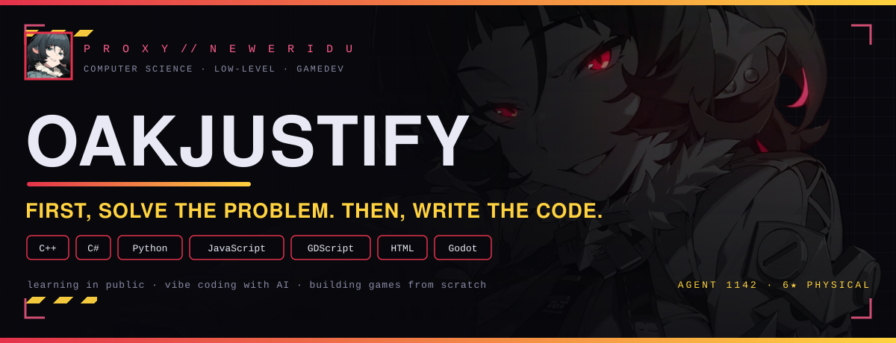
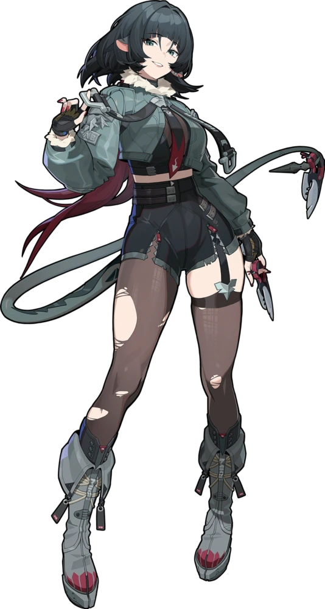
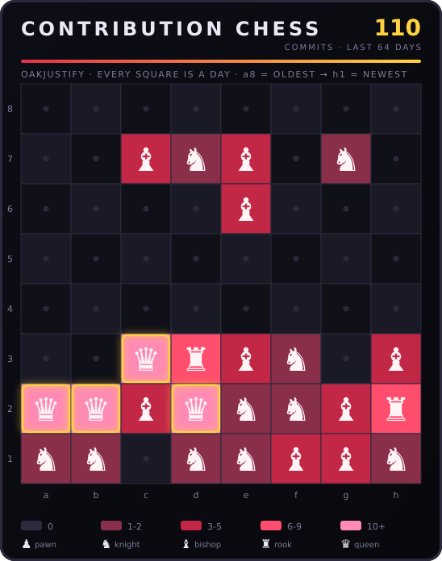
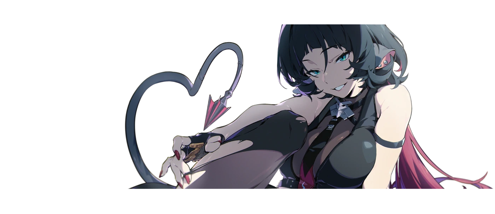

<!--
  ============================================================
  README profile — OakJustify
  Tema: Jane Doe · Zenless Zone Zero

  Struktur file:
    assets/header.svg            -> poster utama (dibuat scripts/header.py)
    assets/chess.svg             -> catur kontribusi (dibuat scripts/chess_contrib.py)
    profile-3d-contrib/*.svg     -> 3D contribution (dibuat .github/workflows/visuals.yml)
    snake-output branch          -> animasi ular (.github/workflows/snake.yml)

  Semua gambar lokal memakai path relatif (./assets/...) supaya tidak
  bergantung pada hotlink pihak ketiga.
  ============================================================
-->

  

  

  
  
  
  
  

 

---

## ⚡ SIGNAL ACQUIRED

<table>
  <tr>
    <td width="62%" valign="top">
      <h3>Halo, saya <b>OakJustify</b> — Junior Developer.</h3>
      
Saya sedang belajar membangun software dari nol: <b>C++</b> di kampus,
      <b>C#</b> untuk kebutuhan pribadi, <b>JavaScript</b> untuk bot Discord,
      dan <b>Godot</b> untuk Understand game. Repo saya pada dasarnya adalah
      catatan perjalanan — mulai dari <code>01_GuessNum</code> sampai bot Discord
      yang online 24/7 di Oracle Cloud.

      
Di luar koding, saya seorang fan Zenless Zone Zero dan sedang membangun
      website fanmade untuk <b>Jane Doe</b>. Karena itu tema profil ini
      bertema <i>New Eridu</i>.

      

        
        
        
      

      

        
        
      

    </td>
    <td width="38%" align="center" valign="middle">
      
       
      <i>“Lady, mind if I take a look?”</i>
    </td>
  </tr>
</table>

 

---

## 🏙️ CONTRIBUTION CITY — 3D

  

  
    Di-generate tiap hari oleh
    <a href="https://github.com/yoshi389111/github-profile-3d-contrib">github-profile-3d-contrib</a>
    · palet warna Jane Doe.
    <b>Hold</b> untuk menganimasikan.
  

 

---

## ♟️ CONTRIBUTION CHESS

  

  
    64 hari terakhir = 8×8 papan catur. Setiap kotak adalah satu hari;
    jenis bidak menunjukkan intensitas commit hari itu.
    Dibuat sendiri oleh <code>scripts/chess_contrib.py</code>.
  

 

---

## 🐍 SNAKE

  <picture>
    <source media="(prefers-color-scheme: dark)" srcset="https://raw.githubusercontent.com/OakJustify/OakJustify/snake-output/snake-dark.svg">
    <source media="(prefers-color-scheme: light)" srcset="https://raw.githubusercontent.com/OakJustify/OakJustify/snake-output/snake-light.svg">
    
  </picture>

 

---

## 📊 STATS

  <picture>
    <source media="(prefers-color-scheme: dark)" srcset="https://github-readme-stats.vercel.app/api?username=OakJustify&show_icons=true&hide_border=true&include_all_commits=true&bg_color=0d0d16&border_color=e4324b&ring_color=ff5c8a&icon_color=ffd23f&text_color=e9e9f5&title_color=ffd23f">
    <source media="(prefers-color-scheme: light)" srcset="https://github-readme-stats.vercel.app/api?username=OakJustify&show_icons=true&hide_border=true&include_all_commits=true&bg_color=ffffff&border_color=e4324b&ring_color=ff5c8a&icon_color=e4324b&text_color=0d0d16&title_color=a81f3c">
    
  </picture>
  <picture>
    <source media="(prefers-color-scheme: dark)" srcset="https://github-readme-stats.vercel.app/api/top-langs/?username=OakJustify&layout=compact&hide_border=true&bg_color=0d0d16&border_color=e4324b&ring_color=ff5c8a&icon_color=ffd23f&text_color=e9e9f5&title_color=ffd23f">
    <source media="(prefers-color-scheme: light)" srcset="https://github-readme-stats.vercel.app/api/top-langs/?username=OakJustify&layout=compact&hide_border=true&bg_color=ffffff&border_color=e4324b&ring_color=ff5c8a&icon_color=e4324b&text_color=0d0d16&title_color=a81f3c">
    
  </picture>

<!--
  Kalau workflow metrics.yml sudah pernah sukses, aktifkan blok ini
  (file-nya ada di assets/metrics.stats.svg & assets/metrics.languages.svg):

  

    
    
  

-->

 

---

## 🧰 TECH STACK

  

<table>
  <tr>
    <th align="left" width="180">System &amp; Low Level</th>
    <td>C++ · C · C# · Python · Algorithms · Data Structures</td>
  </tr>
  <tr>
    <th align="left">Web &amp; Bot</th>
    <td>JavaScript · TypeScript · Node.js · discord.js v14 · HTML · CSS</td>
  </tr>
  <tr>
    <th align="left">Cloud &amp; DevOps</th>
    <td>Oracle Cloud · DisCloud · Docker · Linux · Git · GitHub Actions</td>
  </tr>
  <tr>
    <th align="left">Game &amp; Graphics</th>
    <td>Godot · GDScript · Unity · Blender · Computer Graphics</td>
  </tr>
</table>

 

---

## 📦 SELECTED REPOS

<table>
  <tr>
    <td width="50%" valign="top">
      
    </td>
    <td width="50%" valign="top">
      
    </td>
  </tr>
  <tr>
    <td valign="top">
      
    </td>
    <td valign="top">
      
    </td>
  </tr>
</table>

 

---

## 📡 SIGNAL

<!-- Ganti setiap href="#" dengan link akun kamu. -->

  
  
  
  
  
  
  

 

---

  

    

  

  <h3>“Sorry, milady's busy right now.”</h3>

  
    Dibuat dengan <b>♥</b> oleh <a href="https://github.com/OakJustify">OakJustify</a> 
    Artwork © <a href="https://zenless.hoyoverse.com">COGNOSPHERE</a> ·
    <a href="https://zenless-zone-zero.fandom.com/wiki/Jane_Doe">Zenless Zone Zero</a> 
    <i>README fan project — bukan afiliasi resmi HoYoverse.</i>
  

